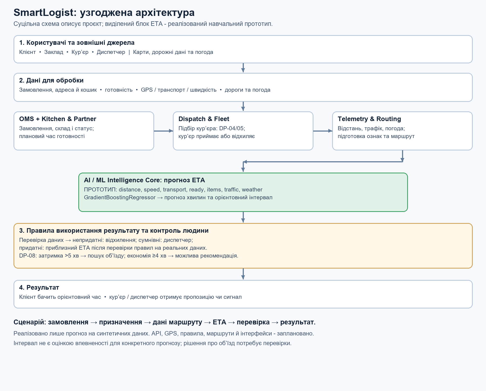

# SmartLogist: проєкт міської доставки з прогнозом часу

Навчальний проєкт із дисципліни «Проєктування інформаційних систем та технології штучного інтелекту», ПР-1–ПР-8. Автор: Дідик Богдан Ігорович, група 201ДОФ23.

## Problem — проблема

Клієнту потрібен зрозумілий орієнтовний час доставки, а закладу та кур'єру — узгоджені дії. На результат впливають готовність замовлення, відстань, транспорт, стан дороги і погода. Надто оптимістичний прогноз може призвести до неочікуваного запізнення.

## Users — користувачі

- **Клієнт** створює замовлення та отримує орієнтовний час доставки.
- **Заклад** повідомляє стан і час готовності замовлення.
- **Кур'єр** приймає або відхиляє пропозицію та виконує доставку.
- **Диспетчер** перевіряє нестандартні ситуації та рішення, що потребують людини.

## Solution — рішення

SmartLogist спроєктовано як систему, у якій дані про замовлення, кур'єра і маршрут надходять до сервісів. Компонент ШІ оцінює залишок часу до вручення. Результат може використовуватися для орієнтовного ETA і підтримки рішень щодо маршруту після перевірки даних та правил. **Працює тільки навчальний прототип прогнозу**; застосунки, сервіси та наведені нижче правила є проєктом.

## Architecture — архітектура



- **OMS + Kitchen & Partner Service** — замовлення, кошик, стан і готовність.
- **Dispatch & Fleet Allocator** — умови призначення та пропозиція кур'єру.
- **Telemetry & Routing Service** — маршрут, відстань, дані дороги, підготовка ознак та використання прогнозу.
- **AI / ML Intelligence Core** — прогноз хвилин до вручення та орієнтовний інтервал.
- **Диспетчер** — перевірка нестандартних і спірних ситуацій.

Задумана інфраструктура ПР-4 також включає API Gateway, обмін подіями, сховища замовлень і телеметрії та сервіс підтримки. Вони не реалізовані в цьому репозиторії.

### Наскрізний сценарій

1. Клієнт створює замовлення; OMS зберігає склад та адресу, заклад повідомляє час готовності.
2. Dispatch перевіряє умови транспорту (DP-04), підбирає кур'єра (DP-05) і надсилає пропозицію; кур'єр може її відхилити.
3. Telemetry готує ознаки маршруту; AI Core повертає прогноз часу та інтервал, який передається назад у Telemetry.
4. Система перевіряє придатність даних і результату. Після перевірки правил на реальних даних може бути показаний приблизний ETA; сумнівні ситуації передаються диспетчеру.
5. Якщо прогнозована затримка відносно контрольного часу понад 5 хв, у проєкті передбачено пошук об'їзду (DP-08). Альтернатива може бути рекомендована, якщо вона доступна і заощаджує не менше 4 хв; складні випадки перевіряє людина. Кур'єр може відхилити пропозицію.

Це **сценарій проєктованої системи**, а не демонстрація вже підключених сервісів чи маршрутизації. Для визначення затримки потрібен обіцяний або контрольний час, якого в поточному прототипі немає.

### Узгодження ПР-1–ПР-7

Відповідність сценаріїв ПР-3 компонентам архітектури:

| Сценарій | Компоненти, що його підтримують у проєкті |
| --- | --- |
| UC-01 — оформлення | Клієнтський інтерфейс, API Gateway, OMS; DP-01 — перевірка зони. |
| UC-02 — призначення | OMS і Dispatch & Fleet; DP-04/05 та відповідь кур'єра. |
| UC-03 — об'єднання замовлень | OMS і Dispatch & Fleet; DP-06 з перевіркою обмежень. |
| UC-04 — підготовка | Kitchen & Partner і OMS; час готовності передається для розрахунку. |
| UC-05 — вручення | Інтерфейс кур'єра, Telemetry та OMS; підтвердження DP-07. |
| UC-06 — зміна маршруту | Telemetry & Routing, AI Core, кур'єр і за потреби диспетчер; DP-08/09. |
| UC-07 — скарга | Support / SLA і OMS; звернення перевіряє оператор. |
| UC-08 — баланс флоту | Dispatch & Fleet, агреговані дані попиту та диспетчер. |

Ці сценарії є проєктними, крім окремо реалізованого навчального прогнозу ETA.

| Робота | Внесок у фінальне рішення |
| --- | --- |
| ПР-1 | Проблема, межі системи, учасники та очікувана цінність. |
| ПР-2 | Дані замовлення і готовності використовують OMS/Kitchen; дані кур'єра і дороги — Dispatch/Telemetry; підготовлені ознаки надходять до AI Core. |
| ПР-3 | Сценарії та точки DP-04/05/08 пов'язано з Dispatch і Telemetry; підтвердження вручення DP-07 та контроль зупинки DP-09 залишаються проєктними функціями. Скарги й баланс флоту належать підтримці та Dispatch. |
| ПР-4 | Компоненти та потоки зведено на фінальній схемі. |
| ПР-5 | ETA — функція AI Core. Згаданий раніше LightGBM був варіантом проєктування; реалізований навчальний прототип використовує іншу модель — scikit-learn `GradientBoostingRegressor`. |
| ПР-6 | Реалізовано окремий прогноз ETA на синтетичних даних; вхідна відстань уже розрахована. |
| ПР-7 | Помилки і межі застосування враховано в запропонованих правилах, але вони ще не реалізовані. |

ПР-2 описувала шкалу заторів 1–10 і погоду зі снігом, а код ПР-6 очікує затори **0–9** і лише **ясно / дощ**. Майбутній сервіс має явно узгодити шкали й обробити непідтримувані погодні умови; сніг не можна просто передавати моделі. Прототип не перевіряє всі такі випадки автоматично. У ПР-3 для дистанції понад 4 км зазначено вибір авто, тоді як довгі піші приклади ПР-7 — окремі стресові тести математичної функції ETA, а не дозволені сценарії призначення. Правило DP-04 саме потребує перевірки на реальних даних.

## AI component — компонент ШІ

Модель прогнозує кількість хвилин **від моменту розрахунку до вручення**. Ознаки: `distance_km`, `speed_kmh`, `transport`, `ready_min`, `items`, `traffic`, `weather`. Категорії перетворюються на двійкові ознаки. Повертається Python-словник із прогнозом і межами інтервалу, придатний до перетворення на JSON. Відстань подається готовою: GPS і карти не підключені.

На 300 штучних прикладах ПР-6 перші 240 використано для навчання, наступні 40 — для калібрування, останні 20 — для тесту. Інтервал будується з калібрувальних помилок, радіус приблизно 5,24 хв. Його майже стала ширина не є індивідуальною впевненістю моделі та не гарантує правильного прогнозу.

## Prototype — запуск прототипу

Потрібні Python і залежності з `requirements.txt`. Перевірене середовище: Python 3.14.6, scikit-learn 1.9.1, NumPy 2.5.4, SciPy 1.18.1. У корені проєкту:

```powershell
python -m venv .venv
.\.venv\Scripts\python.exe -m pip install -r requirements.txt
.\.venv\Scripts\python.exe prototype\practice_6.py
.\.venv\Scripts\python.exe tests\evaluate.py
```

Для macOS/Linux використовуйте `.venv/bin/python` замість `.venv\Scripts\python.exe`. Окремо можна відкрити [ноутбук](prototype/SmartLogist_Prototype.ipynb) у Jupyter або Google Colab і виконати всі комірки. Скрипт тестування повторно створює `tests/test_results.json` та `tests/test_results.csv`, перезаписуючи їх.

Приклад із ПР-6: 3,4 км, велосипед, швидкість 16,7 км/год, готовність через 1 хв, 5 позицій, затори 3/9, ясно → прогноз **19,5 хв**, інтервал **14,3–24,8 хв**. Очікуваний час цього синтетичного прикладу — 14,5 хв. Значення інтервалу обчислюються до округлення.

## Results — результати тестування

| Перевірка | MAE | Абсолютна похибка ≤5 хв | Покриття інтервалу |
| --- | --- | --- | --- |
| ПР-6: 20 тестових записів | 3,05 хв | 16/20 | 16/20 (80%) |
| ПР-7: 60 нових записів | 3,20 хв | 51/60 (85%) | 52/60 (86,7%) |

У ПР-7 використано нові синтетичні приклади з іншим випадковим зерном, але за тією самою формулою, що й навчальні дані. Метрики ПР-7 розраховані за округленими значеннями. Вибірки ПР-6 і ПР-7 різні; їх порівняння не доводить зміни якості моделі. Наприклад, у записі № 340 прогноз 56,3 хв, очікуване значення 86,5 хв — недооцінка на 30,2 хв; реальний час не потрапив до інтервалу моделі. Збережені [результати ПР-7](tests/test_results.csv) містять усі 60 прикладів.

## Limitations — обмеження

- Це синтетичні дані і навчальний експеримент, а не історія реальних доставок. Вибірки не підтверджують якість у реальних умовах.
- Модель не є повноцінною службою доставки. API, бази, GPS, картографія, клієнтські інтерфейси, вибір кур'єра, об'їзд та резервний режим не реалізовані.
- Правила перевірки даних і передавання диспетчеру лише запропоновані. Фактична помилка зазвичай відома після вручення, тому не може бути критерієм рішення під час доставки.
- Поріг ширини інтервалу 12 хв з ПР-7 є навчальним: через майже сталу ширину близько 10,5 хв він практично не відділяє ризикові прогнози.
- Код демонстраційний: не розрахований на довільні непідтримувані значення, експлуатацію з чутливими даними або автоматичне прийняття критичних рішень.

## Future development — подальший розвиток

1. Зібрати належним чином підготовлені реальні історичні дані та визначити межі їх використання.
2. Перевірити якість за часом і групами маршрутів, оцінити великі помилки й повторно відкалібрувати інтервали.
3. Реалізувати перевірку актуальності та допустимості даних, узгодження категорій і окрему оцінку невизначеності.
4. Розробити API, інтеграцію з маршрутами й контрольним часом, резервний режим та інтерфейс диспетчера; перевірити проєктні пороги перед застосуванням.

## Структура

```text
docs/architecture.png                   фінальна архітектурна схема
prototype/practice_6.py                  навчальний прототип ПР-6
prototype/SmartLogist_Prototype.ipynb   той самий експеримент у ноутбуці
prototype/results.json                  результати ПР-6
tests/evaluate.py                       розширена перевірка ПР-7
tests/test_results.csv, .json           усі результати ПР-7
report/                                 фінальний PDF-звіт ПР-8
requirements.txt                        версії залежностей
```
